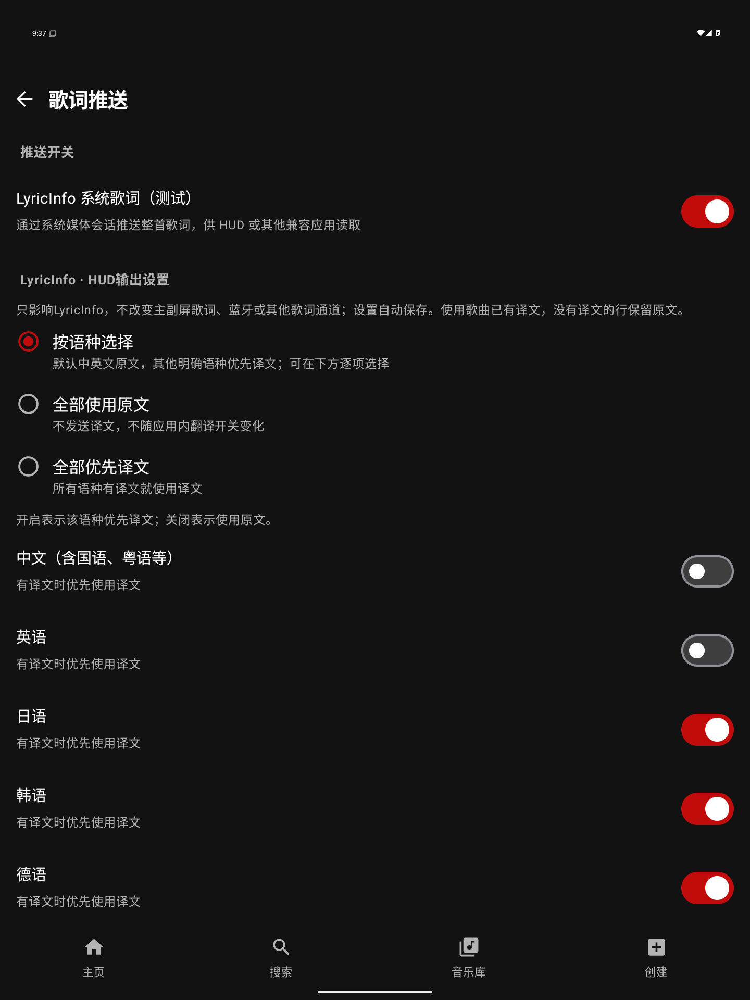
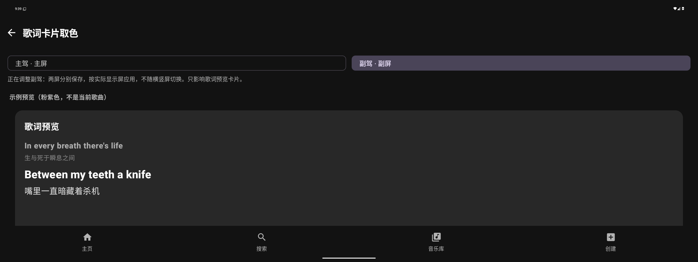

# Melodia For L7

面向**吉利银河 L7 / FlymeAuto** 的 Melodia Android 车机适配版。它以 [rinchao0721/Melodia](https://github.com/rinchao0721/Melodia) 为基础，保留第三方网易云音乐客户端的播放、歌单和歌词功能，并针对车内的主驾竖屏与副驾宽屏调整布局和交互。这是社区维护的 Fork。

**[下载 Melodia For L7 2026.11.21](https://github.com/201SAndvic/Melodia-For-L7/releases/tag/l7-2026.11.21)** · [全部版本](https://github.com/201SAndvic/Melodia-For-L7/releases)

## 车机版功能

- **主副屏共用播放。** 主屏 `1440 × 1920`，副屏 `2880 × 1080`，均按 `160 dpi` 适配。副屏通过 Android `Presentation` 显示，两块屏幕共享同一个播放器，但分别保留页面状态。
- **横竖屏播放页。** 根据可用空间调整封面尺寸和播放控件布局；宽屏为封面与播放控制、歌词等卡片预留空间。
- **歌词卡片与推送。** 主副屏可分别设置卡片颜色，未保存过设置时默认深灰。头像侧栏的「歌词推送」可直达 LyricInfo 与 HUD 输出设置，和原歌词设置共用配置。接收端需要支持 LyricInfo。
- **播放与诊断。** 移植了私人漫游队列修复和大歌单后台补齐队列，削减切页的渲染开销。遇到偶发断音时，可在「诊断与日志」开启记录并手动标记；断音根因仍待确认。

<table>
  <tr><th>主屏：歌词推送</th><th>宽屏：副驾歌词卡片预览</th></tr>
  <tr><td></td><td></td></tr>
</table>

截图来自 Android 15 模拟器，两个尺寸在单显示器上分别验证。目标车机为 Android 11 / API 30；**本版实车双屏同步及 HUD 接收尚未验证**。其他车型能否开启副屏取决于系统是否向应用开放可用的副屏。

## 安装

从 Release 的 **Assets** 下载 `Melodia-For-L7-2026.11.21.apk`。应用包名是 `com.lin0721.linmusic`，本版 `versionCode` 为 `206`。APK 沿用此前车机测试版的签名；若已安装的上游版或自行构建版本使用不同签名，Android 会拒绝覆盖安装。卸载会清除该应用的本地数据，操作前请自行备份。

## 从源码构建

车机版源码在 `l7` 分支，`main` 保留 Fork 时的上游版本。本次源码对应标签 `l7-2026.11.21`。项目使用 JDK 21、Gradle Wrapper 9.3.1 和 Android SDK 36.1。安装 Android SDK 后，用 `ANDROID_HOME` 或本地 `local.properties` 指定 SDK 目录。

```sh
./gradlew :app:testDebugUnitTest :app:assembleRelease -PreleaseVersionName=2026.11.21 -PreleaseVersionCode=206
```

Windows 上用 `gradlew.bat`。APK 生成在 `app/build/outputs/apk/release/`。未配置发布密钥时使用本机调试签名，不能假定自建 APK 可以覆盖这里的发行包。版本采用日期命名，内部 `versionCode` 独立递增。

## 来源与许可

感谢 [rinchao0721/Melodia](https://github.com/rinchao0721/Melodia) 及原项目贡献者。本仓库保留上游提交关系与 [MIT 许可证和版权声明](LICENSE)。车机适配和发行由本 Fork 维护。
